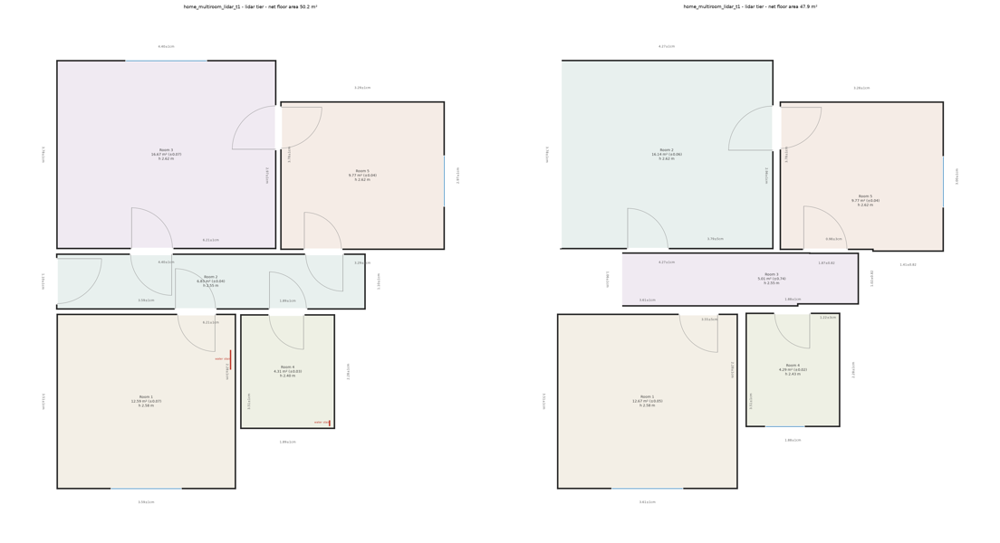

# floorscan — technical report

Dhruv · October 2026 · repo tag `submission` · every number below is from `reports/synthetic/benchmark.md`
(generated by `make benchmark`) or `fixloop/RESULT.md` (generated by `make fixloop`).

**What exists, honestly stated.** One pipeline, three capture tiers, the full output contract, an evaluation harness
with every gate in the brief, a fix loop, and a capture protocol a non-engineer can follow. **Real captures do not
exist yet**: I had no property, Pro iPhone or laser measurer while building. All numbers here come from a
*synthetic* benchmark: a ray-cast renderer that writes the real capture formats (a Stray Scanner folder, a .mp4
walkthrough, per-room JPEG folders with iPhone EXIF) and injects the errors real sensors have. The video/photo
tiers ran through an *oracle* backend: ground-truth depth degraded by a stated error model. The learned backend
(MapAnything) is written against its upstream API but has not been executed, because Hugging Face was unreachable
from the development sandbox. Real-capture numbers come from `make benchmark-real` with no code changes.

## 1. Architecture

```
capture ─► tier front-end ─► Observations ─► geometry core ─► rooms / walls / openings / levels (value, se)
  LiDAR: Stray Scanner frames (depth, conf, ARKit pose) ─► drift pose graph ─┐
  video: keyframes ─► backend (MapAnything | DA-V2+PnP | oracle) ─► gravity ─► drift pose graph ─┤─► build_observations
  photo: per room folder ─► backend ─► gravity ──────────────────────────────┘   (one per folder)
geometry core ─► damage (surface rasters) ─► rules ─► scope ─► stitch (photo: doorway solver)
             ─► calibration (only place ci90 is set) ─► JSON (schema-validated) + SVG/PNG plan
```

*Observations* is the single intermediate: metric, z-up points with a per-point noise level and the camera that saw
each point, plus no-return rays and the posed frames. Below it, no code branches on tier. The tier only sets the
depth noise model and the calibration factors. The LiDAR tier needs no learned weights, so it runs with no GPU and
no network.

**Geometry core** (`scan/geometry/`).
1. Fit a Manhattan frame from wall normals, and floor and ceiling levels from histogram modes.
2. Find wall lines as peaks of the coordinate histogram of wall-facing points, split by facing. Lines that are too
   short, or whose points span < 1 m vertically, are dropped.
3. Build rooms as unions of cells of the wall-line arrangement. A cell is *interior* when floor, ceiling or
   furniture-top coverage is high enough. Cells merge unless the shared edge shows wall in the **header band**
   (the top 0.3 m under the ceiling, and above door height). A doorway therefore never separates rooms; its header
   does. Wall-thickness strips are recognised by their two opposite faces.
4. Bind each room edge to a fitted plane, so a wall length is a difference of two plane fits made from thousands of
   points.
5. Find **openings from free space**. A camera ray that ends behind a wall plane crossed it at an open spot, and
   no-return rays count (glass, beyond range). A wall nobody looked at, or that sits behind a wardrobe, therefore
   never becomes a phantom opening. The jamb position is the median of reveal points seen from the measuring side.
6. Detect **mirrors**. Wall-parallel geometry seen behind a wall is reflected across it. If it lands on the room's
   own surfaces and the blob has no jamb reveals, all phantom points through it are dropped.

Tolerances use the measured surface thickness: the larger of the local scatter and the spread about the strongest
planes. They do not use the sensor's absolute range sigma, which is about 6 cm on video and would make every window
swallow neighbouring surfaces.

## 2. Tiers and device matrix

| Tier | Hardware | App | Depth / poses | Synthetic: median wall err | worst ceiling | openings <= 2 cm |
|---|---|---|---|---|---|---|
| LiDAR | iPhone 15-17 Pro, iPad Pro | Stray Scanner | LiDAR + ARKit | 0.14 % (max 0.6 %) | 0.55 cm | 22/37 |
| Video | any iPhone 15+ | Camera 1x | MapAnything, chunked + Umeyama | 0.64 % (max 2.2 %) | 4.8 cm | 21/30 |
| Photo | any iPhone 15+ | Camera 0.5x | MapAnything per folder | 2.1 % (max 36 %) | 17 cm | 9/45 |

**Capture route 2** (`capture/PROTOCOL.md`, one page). The Stray Scanner pose convention was checked against the
app's source: cam-to-world, OpenCV camera axes, ARKit y-up world. Photos use the 0.5x lens because coverage per
shot matters more than sharpness with 2-8 shots. Every doorway gets a portrait photo from the opposite wall, so
both sides of each connection are seen. Corridors get end-wall shots. These last two rules were added after the
synthetic benchmark showed corridors and door headers going unobserved.

## 3. Drift handling and ablation

Frames are split into fragments of about 3 s. 4-DoF point-to-plane ICP (gravity trusted) links consecutive
fragments, and any fragments whose clouds come within 2.5 m of each other: rooms visited again, and the walk's
return to its start, which the protocol requires. A robust least-squares pose graph is then solved.
`--no-drift-correction` produces the ablation; *poses as-is* never ship.

| Capture | footprint err on / off | median wall err on / off | loop-edge error before → after | adjacency on / off |
|---|---|---|---|---|
| home LiDAR (5 rooms) | +0.11 % / -4.49 % | 0.62 / 1.31 cm | 24.0 → 0.20 cm | correct / **wrong** |
| holdout LiDAR | -0.02 % / -3.34 % | 0.22 / 0.62 cm | 8.4 → 0.26 cm | correct / **wrong** |



*Home LiDAR, drift correction on (left) vs off (right).*

## 4. Error budget (LiDAR tier, from the synthetic error sources)

| Source | Injected | Effect on a 4 m wall | How it is handled |
|---|---|---|---|
| Range noise 1.5-3 mm + 0.15 %·d | white + low-frequency | < 1 mm after the plane fit | thousands of points per plane, effective patch count in se |
| LiDAR scale bias | N(0, 0.15 %) per capture | ~0.3 cm (shared by all walls) | correlated term in se; bias shows up as such in the ceiling table |
| Edge smear ("flying pixels") at depth steps | 2 px blur, 70 % of edge pixels | 1-5 cm on jambs | median of reveal points; **still the dominant opening error (p90 5 cm)** |
| ARKit-like drift | 0.8 %/m translation, 0.06°/m yaw | 1-3 cm wall error, wrong adjacency | pose graph (table above) |
| Residual misregistration between sweeps | after correction | doubled wall surfaces (a few cm) | 6 cm see-through threshold, empty-face check |

## 5. Calibration

Each interval is built as `ci90 = max(1.645·k[tier,kind]·se, floor_rel[tier]·|value|, floor_abs[kind])`:
* `se` is the analytic plane-fit error (an independent-patch count plus a correlated depth-bias term), combined
  with the frame-bootstrap spread of the measurement step (structure fixed, 4-8 resamples).
* `k` is fitted conformally, leave-one-room-out, so a room is never calibrated on itself.

Coverage at a 90 % target: LiDAR walls 92 % (median width 2.6 cm), video walls 95 % (9 cm), photo walls 92 %
(65 cm). No (tier, kind) cell falls below 75 %, so no confident garbage. The photo tier is honest because it is
wide: the fitted photo wall factor is 12, since per-room metric scale error dominates and the analytic se cannot see
it. The shipped `calibration.json` is the synthetic fit, labelled interim. It must be refit on real captures
(`make benchmark-real --write-calibration`), because a fit on our own error model is circular.

## 6. Fix loop

**Gate.** Photo-tier whole-property stitch, the worst gate by distance: it failed on 2/2 captures, with the home
footprint at +28.2 % against ±8 %. The declaration (`fixloop/DECLARATION.md`, commit `a81cc55`) was committed
**before** the fix (`184193c`). It named two root causes, each with evidence from a deterministic probe
(`fixloop/probe_photo_stitch.py`):
* **A.** A 0.3 m unobserved gap in the header band over a doorway let the bath leak into the hall, making a 20.5 m²
  polygon where the truth is 6.8 m².
* **B.** A doorway between two near-identical rooms (3.37 m and 3.39 m deep) was taken for a mirror. Disabling the
  mirror test alone made that capture pass.

The fix is 48 lines (`fixloop/fix.diff`): bridge header gaps up to 0.6 m, and never call a blob with jamb reveals
a mirror.

**Outcome.**
* Both mechanisms are confirmed. On our draw the home footprint went from +28.2 % to +1.2 %.
* In the reproducible run (`make fixloop`, content-seeded noise), the holdout went from +13.9 % footprint, 12.4 m²
  of room overlap and 5 missing doorways, to -7.5 %, no overlap and 1 missing doorway.
* The gate still fails on one doorway per capture that is detected from one side only. That is a third,
  independent defect, so the prediction was right on mechanism and size and wrong on the pass. The post-mortem and
  the next fix are in `fixloop/RESULT.md`.
* No other gate regressed (full benchmark rerun).

**Process note.** An independent two-axis code review (spec and standards sub-agents) found that the synthetic
noise was seeded from file paths, so another machine would have produced different numbers. The before/after tags
were rebuilt so both regenerate anywhere; the original order of the tags is preserved as `fixloop-v1-*`.

## 7. Gate status (synthetic, after the fix)

| Gate | Result |
|---|---|
| Opening widths ≤ 2 cm on ≥ 85 % (LiDAR) | **fail**: 59.5 % (median 0.8 cm, p90 5.0 cm; 2 missed, 2 phantom) |
| Ceiling ≤ 1.5 cm, spread ≤ 1 cm (LiDAR) | **fail by 0.01 cm**: worst error 0.55 cm, spread 1.01 cm, diagnosed *unrepeatable* (not biased) |
| Repeatability (LiDAR) | **fail**: 11/12 wall pairs, worst 1.78 cm |
| Drift accountability | **pass** (both multi-room LiDAR and video captures) |
| Photo whole-property stitch | **fail**: home pass, holdout 1 doorway missing |
| Walls: LiDAR ≤ 1 % (assumed), video ≤ 3 %, photo ≤ 8 % | **pass** (100 % / 100 % / 96 % within) |
| Holdout property (never inspected during development) | LiDAR walls 0.07 % median, adjacency correct; openings 8/17 |

**Runtime** on a 2-core CPU: about 140 s for a 5-room LiDAR walk (geometry 50 s, damage 36 s), 30 s for 5 photo
rooms, 14 s for one LiDAR room.

## 8. Known failure modes

* **Opening widths on LiDAR (p90 5 cm).** Edge smear puts flying pixels on the jamb reveals, and some jambs are
  seen by only a few frames. Next: fit the jamb plane using reveal points whose normal runs along the wall
  (already used for mirrors), and use `conf == 2` pixels only at jambs.
* **Damage.** Classical colour anomalies restricted to fitted surfaces. This gives 1-5 false positives on
  multi-room captures, video/photo stain areas off by 10-28 %, and a missed crack in the multi-room LiDAR run.
  The open-vocabulary gate hook exists but is not wired to weights.
* **Photo tier.** One-sided doorways break adjacency; per-room scale error (assumed 2.5 %) makes ceilings and
  repeatability poor. Intervals are wide accordingly.
* **Not Manhattan.** Angled walls are flagged in a warning and approximated. Single storey only.
* **Not covered.** Wet or glossy floors are not simulated. Mirrors, glass and low light are covered (mirror test,
  no-return rays, intervals widened by a blurry-frame warning). The video tier's real accuracy is unknown until
  MapAnything runs on real captures. The protocol is the main defence for the walk-in.
